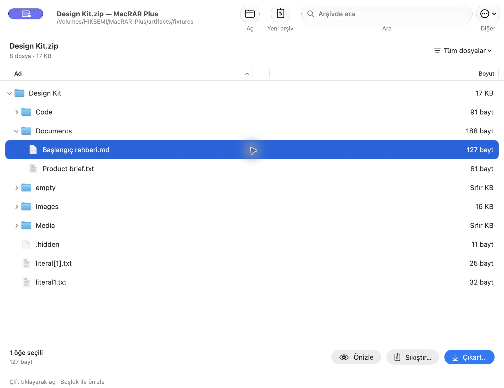
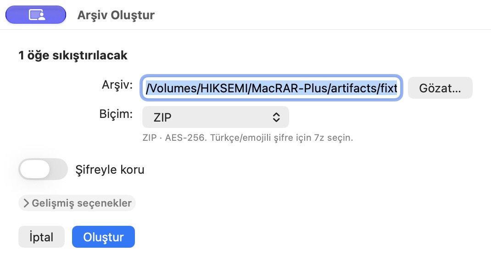

# MacRAR Plus

**2.3.2:** [Feature and verification notes](docs/plus/2.3.2.tr.md). Includes compatibility with the older Swift compiler on macOS 14. A simpler workspace with Preview, Compress and Extract actions, optional file details, a compact type filter, and an uncluttered compression form. Archive map, inventories, advanced search and Finder actions remain available.

An enhanced native macOS archive workspace. Original source copyright notices and the MIT license are preserved in [LICENSE](LICENSE). See [Türkçe kullanım ve teknik notlar](README.tr.md) for complete setup, behavior and limitations.

MacRAR Plus developer: [BerkDrmz](https://github.com/BerkDrmz).

**2.3.2** targets Apple Silicon/macOS 13+. Download the ZIP or DMG from [GitHub Releases](https://github.com/BerkDrmz/MacRAR-Plus/releases/tag/v2.3.2). `./package.sh` produces the same package formats in `dist/`.

Use **Tools → Archive map** (⇧⌘M) to find the largest files, type totals and duplicate candidates without extracting the archive. Candidate groups match size and CRC32; they do not prove identical contents and never delete files automatically. **Locate** selects the file in the archive. The map shows up to 50 files/types/groups, and 20 members per group, while totals cover the complete archive.

Search supports `"annual report" -backup ext:pdf type:file encrypted:no`, `size>10MB`, `after:2026-01-01` and `before:2026-12-31`. Wildcards remain literal. **Tools → Search guide** explains the syntax, with ready-made searches for large, empty and encrypted files. **⇧⌘F** clears search and category filters.

**File → Export file list as CSV/JSON** exports selected items and all contents of selected folders, or the matching listing records when nothing is selected. CSV protects formula-like text; JSON keeps exact names. Export cannot overwrite the source archive or its known volumes. **Edit** offers name/path copying; **File** can reveal the archive in Finder.

The header provides file-type filters. **More** opens advanced tools and optional file details. Name and size columns are shown by default; right-click the column header to add other columns. The workspace includes recent archives, Quick Look (Space / ⌘Y), a serial extraction/integrity-test queue (⇧⌘B), local activity history, background listing, and guarded staged extraction. Add/delete operate on a copy before replacing the original archive. Files stay local.

```sh
./fetch-tools.sh
./build.sh
open "build/MacRAR Plus.app"
./test.sh
./package.sh
```

Apple Silicon, macOS 13+. The local build is ad-hoc signed, not Developer ID signed or notarized. `release.sh` requires your own Apple signing credentials. Bundled RAR creation follows RARLAB trial/license terms; ZIP, 7z and TAR use the free 7-Zip engine. Engine licenses and the source license ship in the application.

Links, special files and unsafe paths are rejected. Archives containing Unix/app symlinks cannot be opened in this edition. Staged extraction keeps failed engine output private; failed multi-file transfers reclaim unchanged outputs and restore destination backups. If an external edit or filesystem error prevents rollback, recovery copies are retained and their location is reported. Archive modification needs disk space for a copy. Split archives are read-only. RAR4 creation is unavailable with the bundled RAR7 engine; RAR4 reading remains supported.




